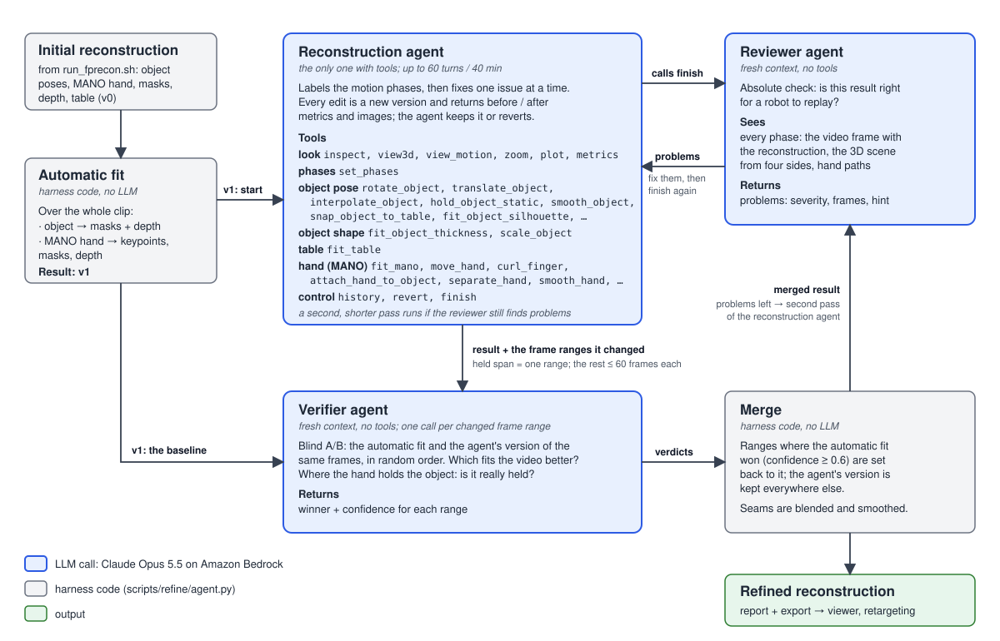

# Project Goal
We want to train a dexterous hand policy that intakes RGB and learns to pick up, in-hand manipulate, and then set down an object solely through video generation data.

## 1.0 Generated videos
We film a few real reference videos per task, then use MiniMax H3 (video-to-video) to make counterfactual versions of each one. Two kinds of edit, following Alvin's plan:

- **Type A (geometry):** same object, with one geometric change (shorter, narrower, larger). This exists to compare directly against sim augmentation, which changes the same properties inside the simulator. [`prompt_prp_type_a.md`](prompt_prp_type_a.md)
- **Type B (object swap):** replace the object with a different rigid object from a fixed list of 10. This is the "as diverse as possible" condition. [`prompt_prp_type_b.md`](prompt_prp_type_b.md)

My clips (filmed 11/19):

| i | Object | pp | prp |
|---|---|---|---|
| 1 | small metal case | `pp_anthony_real_1` | `prp_anthony_real_1` |
| 2 | blue tape roll | `pp_anthony_real_2` | `prp_anthony_real_2` |
| 3 | black spatula | `pp_anthony_real_3` | `prp_anthony_real_3` |
| 4 | gray mug | `pp_anthony_real_4` | `prp_anthony_real_4` |
| 5 | dish soap bottle | `pp_anthony_real_5` | `prp_anthony_real_5` |

Each real video gets 5 Type A and 5 Type B edits at seed 0, so 10 * 10 = 100 counterfactual videos (generated 11/21).
Type A uses A01-A03 from the group doc plus two edits of our own: A04 taller (height 120%) and A05 smaller overall
(all dimensions 80%). Type B splits the 10 objects into interleaved halves, {B01,B03,B05,B07,B09} and
{B02,B04,B06,B08,B10}, alternating over pp_1..pp_5, prp_1..prp_5. So pp_i and prp_i get opposite halves (each source
object meets all 10 targets), and each target is used 5 times. The group prompts are written for prp. The pp clips use
the same text with the in-hand rotation steps replaced by a carry. Both versions are in `videogen/group_prompts.py`,
and the clip list is `configs/videogen/real_20261119.json`.

Results: all 100 succeeded first try, 1344x768 at 24 fps, 56.5 H200-hours in total (about 5 min per pp clip and
12 min per prp clip on 4 H200s). They ran as 10 SkyPilot managed jobs on ll-smo (`scripts/sky/h3_videogen.yaml`).
Videos, prompts and source|generated compare clips are in
`s3://far-research-internal/antzhan/counterfactualhoi/videogen/real_20261119/<clip>/<type_a|type_b>/<ID>/seed0.mp4`.

## 1.1 Begin HOI reconstruction on real / generated videos
We tried [Open-CHOIR](https://github.com/hxwork/CHOIR) and Do-as-I-Do for hand-object reconstruction, but both performed poorly. We've since built our own hand-object interaction reconstruction framework, **VeriHOI**, which combines metric depth (Depth Pro 2), FoundationPose tracking, DynHAMR, SAM3, and SAM3D with optimization + agentic verification and refinement.

### Goal / interface
For each real video, and each generated video that passes 1.0, produce a 4D hand-object trajectory that 1.2 can consume:

- **In:** real or generated video (H3: 1344x768, 24 fps, 4–15 s) + an object prompt for SAM3 segmentation. For generated clips, we will use `<CLS>` from the generation prompt. For the real clips, prompts were hand-picked, and both spatula clips needed point prompts because the text prompt found nothing.
- **Out (hand):** per-frame MANO (pose, shape, global wrist pose). Right hand only for now.
- **Out (object):** one rigid mesh + per-frame 6-DoF pose, in the same camera/world frame as the hand.
- **Out (scene):** camera intrinsics, gravity direction (from GeoCalib), metric scale. 1.2 needs the table plane (all videos are static camera, tabletop manipulation) and gravity.

### Pipeline, status
Old pipeline in [`choir.md`](choir.md).

How it works (four commands per clip: `prepare_clip.sh`, `first_mask.sh`, `CHOIR_STAGE1_ONLY=1 run_choir.sh`, then `run_fprecon.sh`):

1. **Prep and gravity:** `prepare_clip.sh` imports the clip and runs GeoCalib for the gravity direction, which is the initial "up" direction. Gets refined by the agentic framework later using vector normal of the table plane.
2. **Masks and mesh:** SAM3 (image model, text prompts such as `"mug,cup"`) segments the object and hand on every frame, replacing CHOIR's SAM2 tracks (those drifted: a "hand" on the whole table, a hand mask that swallowed the mug, an object mask missing the camera's black panel). SAM3D then builds a textured mesh from frame 0 (CHOIR's copy of SAM3D strips the texture and 95% of the triangles, which is why the earlier viewers looked bad).
3. **Depth:** Depth Pro 2 gives metric depth for every frame, using CHOIR's camera focal length.
4. **Scale from the hand:** compare the MANO hand's depth with the depth map on the visible hand pixels. Depth Pro 2 was already close to metric: the correction factor is 0.95–1.16 across clips.
5. **Object:** FoundationPose tracks the SAM3D mesh on that depth. It sizes the mesh by trying several sizes on the first frame, and re-registers from the mask when a frame-by-frame check says the fit has slipped.
6. **Hand:** each frame's hand is moved onto the depth map, so hand, object, and table all share one metric depth.

Results on the 10 real videos (first/last-frame object mask IoU, both methods scored on the SAM3 masks): 0.80–0.95
vs CHOIR's 0.31–0.74; the object ends 0.4–2.5 cm from the table (CHOIR 3–20 cm); 0–1% of frames flagged by the
per-frame check. Project website: `scripts/site/build_site.py` -> `../CounterfactualHOI-site`.

## 1.2 Agentic Refinement of Reconstructions
Why do we need an agent? These are the failures we've seen, and gradient descent handles most of them badly:
1. **Discrete ambiguities:** the mug tracked with its handle on the wrong side. A gradient can't cross that gap; the agent can look and choose.
2. **Lag in fast motion:** the spatula flip (frames 51–56), where the tracker falls behind and then recovers.
3. **Bad evidence:** SAM2/SAM3 masks missing the camera's black panel or the whole spatula. An optimizer fits wrong masks faithfully; an agent can see that the mask is wrong and down‑weight it.
4. **Physical and semantic constraints:** an object at rest should sit on the table, a grasped object should move rigidly with the hand, and fingers shouldn't pass through the object. These come from understanding the video's phases (approach → grasp → carry/rotate → release), which the agent can label.

The parameters the agent edits:
- Phase labels: frame ranges for approach, grasp, carry, rotate, release and rest. These drive the constraints.
- Object: an SE3 pose for every frame. Shape, the scale along each of the three fixed axes.
- Hand: MANO parameters for every frame
- Table: one plane for the whole clip (every frame's depth is anchored to it); the agent can re-fit it.

| Type | Tools |
|---|---|
| look | `inspect` (overlays on the video; gravity-aligned side/top/front views), `view3d` (any side or a contact close-up; hand red where it passes through the object, green where it touches), `view_motion` (wrist + fingertip paths and a filmstrip: shows jitter), `zoom`, `plot`, `metrics` |
| phases | `set_phases` (approach / grasp / lift / carry / rotate / place / release / rest; drive the contact and grip terms) |
| object | edits: `rotate_object`, `translate_object`, `move_along_ray`, `interpolate_object`, `hold_object_static`, `snap_object_to_table`, `smooth_object`; search: `fit_object_silhouette`, `polish_object` (FoundationPose refiner), `propose_object_poses` + `apply_candidate` |
| object shape | `fit_object_thickness` (searches the object's extent along the first frame's viewing direction, the side that frame never saw; the harness also runs it once after the first `set_phases`), `scale_object` (scales the mesh by a factor the agent chooses, along that direction or the two across it) |
| table | `fit_table` (re-fits the table plane from the depth around the object in frames the agent chooses) |
| hand (MANO parameters only: global pose, 15 joint rotations, shape) | edits: `move_hand`, `move_hand_to_depth`, `separate_hand`, `attach_hand_to_object`, `curl_finger` (MANO joint rotations), `smooth_hand`; **`fit_mano`**: gradient-based fit of the range's MANO parameters to 2D keypoints, masks and depth, with a hand-pose prior, temporal smoothness, no penetration, and contact / grip in the held phases |
| control | `history`, `revert`, `finish` |

The tools above belong to the **reconstruction agent**. Two more agents check its work, and neither has tools: the **reviewer** (is the result right?) and the **verifier** (is it better than the automatic fit?). All three are Claude Opus 5.5 on Amazon Bedrock, each in its own fresh context (`scripts/refine/agent.py`).

Agentic Framework Loop:
1. **Table-anchored depth (no LLM).** The camera is static, but Depth Pro 2's metric scale drifts over a clip: the table's distance changes by up to ±12% between frames, and the depth on the object and the hand changes with it. The harness fits the table's plane in every frame and scales each frame's depth so that the table is one plane for the whole clip. The tracked object, the size of its mesh and the hand are carried along. Up is that plane's normal (`scripts/fprecon/depth_anchor.py`).
2. **Automatic fit (no LLM).** The harness then fits the whole clip: the object to its masks and depth, then the MANO hand to its keypoints, masks and depth. This is v1. The reconstruction agent starts from it, and it is the baseline the verifier compares against.
3. **Overview and phases.** The reconstruction agent gets an overview of v1: outline overlays on the video, side views, 3D views where the hand meets the object, metric plots with flagged frames, and the hand's paths. It labels the motion phases with `set_phases`. The harness then runs `fit_object_thickness` once.
4. **Fix loop.** The agent fixes one issue at a time, with up to 60 turns or 40 minutes. Every edit makes a new version and returns before/after metrics and images of the frames it touched. The agent decides whether to keep the edit or revert it; the harness does not enforce a metric rule.
5. **Reviewer gate.** When the agent calls `finish`, the reviewer checks the result in absolute terms: every phase against the video and in 3D from four sides, plus the hand's paths. If it finds high or medium problems, the finish is refused once: the agent gets the list, fixes what it can, and calls `finish` again.
6. **Verifier and merge.** The harness finds the frame ranges the agent changed. The span in which the hand holds the object is one range; the rest is split at phase boundaries, at most 60 frames each. For each range the verifier sees the automatic fit and the agent's version in random A/B order and says which matches the video better. For the held span, what decides is whether the object is really held. Ranges where the automatic fit wins with confidence ≥ 0.6 are set back to it, and the seams are blended and smoothed. This stops the reconstruction agent from talking itself into an edit.
7. **Second pass.** The reviewer checks the merged result. If high or medium problems remain, the reconstruction agent gets a second, shorter pass on them (25 turns or 20 minutes), verified against the first pass's result.
8. **Outputs.** `final.npz`, `report.md` (the edits, the verifier's verdicts, the reviewer's findings, metrics for initial / automatic fit / final) and `export/` for the viewer and retargeting.

After a round over all clips, `scripts/refine/post_round.sh` runs the reviewer three times per clip (the verdict is the majority), writes the summaries, and runs blind A/B comparisons of the round against the initial reconstruction, the automatic fit and the previous round.

It plugs in as a new refine step after run_fprecon.sh, and the website gets a fourth section, "agent‑refined".

## 1.3 Retarget to robot morphology 

We cast retargeting as an RL tracking problem with FlashDexRetarget (FDR): one policy is trained in simulation (IsaacSim, 2048 envs, FlashSAC) to make a floating-wrist sharpa Wave hand move each clip's object along its reconstructed trajectory. The policy's rollouts are the retargeted motions. Code: `scripts/flashdex/*`

### Pipeline
1. **Import.** Per clip, from the refinement: MANO hand parameters, object poses, table plane; from fprecon: the metric SAM3D mesh. World: z-up, table at 0.8 m, right hand only, 60 Hz.
2. **Scene.** The table is one support disk under the object's path. Objects that tip over at rest get a flat-bottomed collision mesh (visual mesh unchanged).
3. **Kinematic retarget.** IK with collisions in MuJoCo: the Sharpa palm and fingertips follow the MANO wrist and fingertips. This gives a joint reference, not yet physically valid.
4. **RL tracking.** One policy over all 10 clips.
   - Episode: starts at a random frame of a clip, ends with the clip.
   - Action: PD targets; wrist = reference + residual (5 Hz low-pass), fingers = absolute joint targets.
   - Reward: object point-cloud match to the reference (main term), plus wrist, fingertip and joint tracking.
   - Early reset: object dropped, object reward too low, or fingertips far off.
   - Curriculum: a virtual spring holds the object on its reference early on and decays as tracking improves.
   - Observations are privileged (object state, contacts, SDF, 10 future reference frames).
5. **Evaluation.** Every 10M steps: a deterministic rollout of every clip from its first frame, no assist.
   - Progress (AdaDex): share of the clip before the object first leaves 5 cm / 20° of the reconstruction.
   - Success: the whole clip within 5 cm / 20°.

Training speed: `CFHOI_FAST=1` applies run-time patches that make an iteration 1.23x faster without changing what is learned, and more envs raise the env steps per second further (2.9x at 8192 envs). `CFHOI_SGS=1` optionally samples episode starts by their success rate. Details in `scripts/flashdex/README.md`.

## 1.4 Distill into robot policy with the following embodiment and I/O 
From FlashDexRetarget, we have a policy that is capable of tracking any of the hand+object motions in our 3D reconstruction dataset. We need to distill this into a text conditioned flow matching policy (text will be only "pick", "rotate", "place") that can pick, in-hand-rotate, and place objects of various geometries and appearances.

Imagine a Tianji 7 DoF arm with a 22 DoF sharpa connected to the end and a D405 on the wrist like there is in spd.bot. Since spd.bot uses a YAM, we have to mount the wrist camera on the palm side of the hand but it will be near the flange.

| Item | Value |
|---|---|
| Hand | Sharpa Wave, 22 DoF |
| Arm | Tianji 7-DoF force-controlled arm with anthropomorphic cross-axis wrist (see the arm section) |
| Controlled joints | `N = 22 + 7 =` **29** |
| Policy rate | 50 Hz (one step every 20 ms) |
| Low-level control | Built-in joint controllers on hand and arm, servoing faster than the policy; arm targets interpolated between policy steps (see the arm section) |
| Wrist camera | Intel RealSense D405, mounted on the wrist, looking along the hand (as in SPD's per-hand views) |
| Exo camera | Fixed depth camera viewing the workspace (see the exo camera section) |
| Tactile | Not used |

Here is the input design spec of the policy. The outputs are pretty simple, just the 29 joint angle action space.
 
| # | Group | Contents | Frame / encoding | Dim (N = 29) |
|---|---|---|---|---|
| 1 | **Proprioception** | Last 3 frames of measured joint angles `q`, and last 3 frames of the policy's own joint targets `q*` | Each joint normalized to [-1, 1] by its limits | 3 × 2N = **174** |
| 2 | **Object pose (current)** | Position (3) + rotation (6D: first two columns of the rotation matrix) | Robot base frame | **9** |
| 3 | **Future object trajectory** | K = 5 waypoints spaced 100 ms apart (0.1–0.5 s ahead) | Each as a change from the current object pose | 5 × 9 = **45** |
| 4 | **Future hand/arm trajectory** | Reference joint angles at the same 5 time points | Each as a change from current measured `q` | 5 × N = **145** |
| 5 | **Wrist depth (D405)** | Depth image + validity mask → CNN encoder | See the wrist camera section | latent **64** |
| 6 | **Exo depth** | Depth image + validity mask → separate CNN encoder | See the exo camera section | latent **64** |